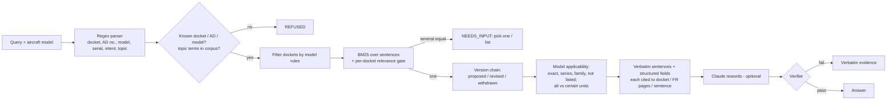

# Torque Stripe — Brainstorm & Handoff

> **Read this first if you are picking up this project (human or AI agent).**
> It is the single source of truth for what we are building, why, what exists, and what to do next.
> Last updated: 31 Oct 2026, ~11:30 SGT.

---

## 0. TL;DR

- **Event:** Autonomous SG 2026 hackathon, NUS (Acacia Hackathon Society x NUS Product Club), 31 Oct 2026.
- **Track:** AI & Aerospace (Airbus). **Challenge #4:** *"How might AI help people find, understand, and verify regulated technical information?"*
- **Product:** **Torque Stripe**, a web app where a licensed aircraft maintenance engineer asks about FAA proposed Airworthiness Directives (NPRMs) and gets **cited, model-checked, revision-aware answers, or a clear refusal**.
- **Core rule (non-negotiable):** **every safety decision is deterministic code.** Claude only rewords evidence the engine already selected. A deterministic verifier drops any reworded sentence it can't trace; on failure we show the verbatim source.
- **Name:** a torque stripe is the paint mark a technician puts on a fastener once it's been verified. It means "checked; if this mark moves, stop." That's what the product does for AD answers.
- **Tagline:** *The AI reads. The rules decide. The engineer signs.*
- **Status:** engine runs on the **real dataset** (431 rows, 323 dockets, 1,302 Federal Register pages). Real-data gold set: **42/42 correct, 0/16 unsafe answers** vs baseline **5/42, 16/16 unsafe** (baseline gets exact docket lookup + BM25). API ready. Web UI done (served by the API at /). **Next: Claude rewording on, cache, deploy, pitch.**

---

## 1. Challenge #4 requirements (from the official brief)

| Requirement (brief wording) | How Torque Stripe meets it | Status |
|---|---|---|
| Traceable, context-aware search engine; ingests multi-page technical docs | Spreadsheet ingest → per-sentence records; SQLite FTS5 index over 1,302 FR pages of summaries | Done |
| Answers natural-language queries with citations | Every sentence is verbatim with docket, publication date, FR volume/number, page range, sheet row, sentence no. | Done |
| Refuse confidently when ambiguous | Statuses + refusal codes; never guesses | Done |
| **Specific references** | `cite` on every claim (see §5) | Done |
| **Zero hallucination** | LLM only rewords selected claims; verifier; verbatim fallback | Done |
| **Configuration filtering** | Model rules: exact / series (FAA "-200 series" convention) / family needs variant / not listed; "all" vs "certain" units | Done |
| **Revision logic** | Docket version chain (proposed → revised → corrected → withdrawn); superseded ADs; latest version decides status | Done |
| **Out of scope / contradicts documents / ambiguous** | `OUT_OF_SCOPE`, `CONTRADICTS_SOURCE`, `NEEDS_INPUT` | Done |
| **Clear communication of uncertainty** | `NEEDS_INPUT`, `REFUSED`, and `MODEL_LISTED_UNITS_UNCONFIRMED` when serial criteria aren't in the data | Done |
| **Sub-3 s retrieval across 1000+ pages** | 1,302 pages; p50 0.2 ms, max 9 ms | Done |
| Avoid LLM guessing | LLM never sees anything but selected claims; never decides status | Done |
| Avoid unformatted data | Structured JSON: status, fields, applicability, revision, claims, trace | Done |

---

## 2. The real dataset (read this before changing the parser)

File: `data/faa/ad_nprm.xlsx` (from the organisers' Drive folder "Challenge 4 Airbus / 432 Entries of FFA Airworthiness Directive"). One sheet, 22 columns, **431 non-empty rows**.

**It is NOT 432 full AD documents.** Each row is one Federal Register publication of a **proposed** AD (NPRM): metadata + a summary paragraph (≤ 294 words).

| Fact | Number | Consequence |
|---|---|---|
| Rows / unique dockets | 431 / 323 | 99 dockets have 2–4 versions → revision chain |
| Row actions (parsed from summary) | new AD 198, withdrawn 123, supersede 79, revised proposal 22, other 9 | Status depends on latest version |
| Docket status | proposed 188, withdrawn 123, revised 12 | Withdrawn proposals impose nothing |
| Model column filled | 86 rows | Rest parsed from summary text (FAA shorthand like "A330-243, -243F, -841") |
| Dockets with a parsed model list | **297 / 323 (92%)** | 26 dockets (seatbelts, "various rotorcraft"…) can't be model-checked → said so |
| Scope wording among parsed | all 101, certain 165, unclear 31 | "certain" → serial/config criteria are only in the full FR text → we **don't confirm** unit applicability |
| Serial ranges in data | none | Serial-level check impossible; we say so explicitly |
| Federal Register pages covered | **1,302** | Meets "1000+ pages" |
| Columns always empty | AC Reference, AIR Policy Reference, Additional Reference | Ignored |
| "Status" column | always "Current" | Useless; we derive status from summaries |

**Key nuance for the pitch:** these are **proposals, not ADs in force**. Every answer carries `binding: "No. This is a proposed rule (NPRM)…"`. A generic chatbot would tell a mechanic "you must do X".

> The Airbus PDF's rubric pages contain an older hidden draft layer ("Draft for discussion with Airbus", unweighted). Harmless. Follow the visible weighted rubric. A full scan of both PDFs found **no hidden prompts or instructions**.

---

## 3. Judging rubric (Airbus track; use the weighted version)

| Criterion | Weight | What wins it for us |
|---|---|---|
| Problem realism | 20% | Named user: **B1 licensed aircraft maintenance engineer / CAMO planner** tracking which proposed ADs affect their fleet. Status quo: reading Federal Register notices; withdrawn and revised proposals mixed in. |
| Technical soundness | 25% | Clear **LLM / non-LLM split**: rules for model coverage, revisions and status; LLM only for wording. |
| Honest evaluation | 20% | Real-data gold set + baseline + coverage stats + visible refusals + two gold-set errors we found and documented. |
| Trust & traceability | 20% | Citations to docket / FR volume / pages / sentence; "proposed, not binding" label; refusal path; trace. |
| Impact | 10% | Baseline 16/16 unsafe → 0/16; withdrawn flagged 0/6 → 6/6. |
| Time discipline | 5% | **Submit early**; 3-minute pitch. |

---

## 4. Why Challenge #4 (decision record)

Expected weighted score (rubric weights × estimated 1–5 scores × chance of finishing): **#4 90.0**, #1 69.0, #3 62.2, #5 60.6, #2 51.0. Under random ±1 error on every estimate (20,000 runs) #4 ranked first 97.9% of the time. Brief asks for exactly a rules-first, cited, refusing system. Multi-agent (that's #2) was rejected: the rubric penalises LLMs making legality/compliance decisions.

**Form factor:** responsive **web app** (laptop/tablet), not native mobile.

---

## 5. Architecture & code



### Files

```
torque-stripe/
├── torquestripe/
│   ├── nprm.py          # REAL DATA: xlsx ingest, action type, model parsing, scope, docket version chains
│   ├── nprm_engine.py   # REAL DATA: query parsing, model rules, ranking, status, citations
│   ├── parse.py / applicability.py / engine.py   # synthetic full-text AD engine (serial ranges); kept for sample mode
│   ├── index.py         # shared tokenizer + FTS index for sample mode
│   ├── phrase.py        # optional Claude rewording + deterministic verify()
│   └── api.py           # FastAPI (auto-selects real or sample engine)
├── data/faa/ad_nprm.xlsx      # real dataset
├── data/sample/               # 4 SYNTHETIC full-text ADs (serial-range demo)
├── eval/gold_faa.json + run_eval_faa.py   # real-data evaluation
├── eval/gold_sample.json + run_eval.py    # synthetic evaluation
├── README.md, HANDOFF.md, requirements.txt (+ openpyxl)
```

### Run

```bash
pip install -r requirements.txt
export ANTHROPIC_API_KEY=sk-ant-...           # optional; server-side only; never commit
export ANTHROPIC_MODEL=claude-sonnet-5-5
uvicorn torquestripe.api:app --reload          # real data by default
python3 eval/run_eval_faa.py                   # real-data eval
```

Endpoints: `GET /health`, `POST /ask`, `GET /models`, `GET /dockets`, `GET /dockets/{docket}`.

```bash
curl -X POST localhost:8000/ask -H 'content-type: application/json' \
  -d '{"query":"main rotor servo-control torque inspection","model":"AS350B3","use_llm":false}'
```

### Statuses and verdicts

| `status` | Meaning |
|---|---|
| `ANSWERED` | Evidence found AND model confirmed for **all** units, or a list answer for a given model, or a withdrawn-proposal answer |
| `ANSWERED_GENERAL` | Information about the proposal, but unit-level applicability not confirmed (no model given, or "certain" units) |
| `NEEDS_INPUT` | Need exact model variant, or several dockets match (see `candidates`) |
| `NOT_APPLICABLE` | User's model isn't in the proposal's model list |
| `REFUSED` | `UNKNOWN_MODEL`, `UNKNOWN_AD`, `UNKNOWN_DOCKET`, `OUT_OF_SCOPE`, `NO_MATCH`, `CONTRADICTS_SOURCE` (question assumes a withdrawal or an AD link the notices don't support), `NOT_IN_DATA` (e.g. compliance times, which NPRM summaries don't state) |

| `applicability.verdict` | Meaning |
|---|---|
| `MODEL_LISTED_ALL_UNITS` | Model listed, summary says "all" |
| `MODEL_LISTED_UNITS_UNCONFIRMED` | Model listed, summary says "certain": criteria only in the full FR text |
| `NEEDS_VARIANT` | User gave a family (A330, A350-900) that matches several variants |
| `NOT_LISTED` | Not in list |
| `UNDETERMINED` | Proposal's model list not machine-readable |
| `NO_MODEL_GIVEN` | — |

**Model rules (deterministic):** exact match; `X series` covers `X…` (777-300 → 777-300ER); FAA convention `-200 series` covers `-2xx` (A330-200 → A330-243); user family `A350-900` matches listed `A350-941` → needs variant; bare `787` accepted only if it's a known family.

### `/ask` response (abridged, real data)

```json
{
  "status": "ANSWERED", "ad": "FAA-2026-11814",
  "revision": {"docket": "FAA-2026-11814", "status": "PROPOSED",
               "versions": [{"date": "2026-10-19", "action": "NEW_AD", "fr": "Federal Register, Volume 91 Number 200 (...)", "pages": "(Pages 66019-66022)", "row": 2, "link": "https://www.federalregister.gov/..."}],
               "supersedes_ads": [], "withdrawn_by": null, "resulting_ad": null},
  "applicability": {"verdict": "MODEL_LISTED_ALL_UNITS", "reasons": ["AS350B3 matches listed model AS350B3.", "Summary says the proposal applies to ALL units of the listed models."]},
  "fields": {"regulatory_status": "PROPOSED", "binding": "No. This is a proposed rule (NPRM), not an AD in force.",
             "comments_due": "2026-12-03 (open)", "models_listed": ["AS350B3", "..."], "scope_wording": "ALL", "link": "..."},
  "claims": [{"id": "FAA-2026-11814@2026-10-19:S3", "text": "This proposed AD would require an inspection of ...",
              "cite": {"docket": "FAA-2026-11814", "version_date": "2026-10-19", "action": "NEW_AD", "fr_citation": "...", "pages": "(Pages 66019-66022)", "link": "...", "sheet_row": 2, "sentence": 2}}],
  "candidates": [], "trace": ["intent=...", "model AS350B3 listed in N dockets", "..."], "latency_ms": 3.7,
  "answer": {"mode": "extractive|llm_verified", "sentences": [...], "rejected": [], "note": "..."}
}
```

### Results (real data, `eval/gold_faa.json`, 42 questions)

| Metric | Torque Stripe | Naive BM25 baseline |
|---|---|---|
| Fully correct (status + docket + verdict + field) | **42/42** | 5/42 |
| Unsafe answers (answered when it should refuse / ask / say not applicable) | **0/16** | 16/16 |
| Withdrawn proposals flagged as withdrawn | **6/6** | 0/6 |
| Latency over 1,302 pages | p50 0.2 ms, max 9 ms | |

**Honesty notes (say these in the pitch):**
- We wrote the gold set; **3 gold items were wrong** and were corrected only after reading the source summaries (VHF radio issue has two separate withdrawn proposals; an A350-941 landing-gear NPRM exists; the AmSafe seatbelt proposal was withdrawn). All noted in `gold_faa.json`.
- First run was 29/33 with 2 unsafe answers; fixes were general rules (series convention, stricter out-of-scope gate, per-docket relevance gate), not per-question patches.
- Model-list parse: 92% of dockets. Spot-check of 14 random parses found 1 bug (747SP), fixed.

### Visible failures (shown live in the Evaluation tab, from `eval/known_failures.json`)

1. Synonyms like "pulled back" aren't understood → safe refusal.
2. Vague question with several matching proposals is routed to the top one before a refusal names it.
3. Supersede notices: model list can describe the old AD's wider applicability.
4. 26 dockets have no model list → applicability unknown. **Found in testing:** the model filter used to drop them silently (a missed proposal); fixed, now kept and marked UNDETERMINED.

### Known limits

- Unit-level applicability for "certain" proposals (165 dockets) can't be confirmed: the dataset has no serial ranges. We say so and link the FR page.
- Scope "all" is read from the summary's first sentence; for supersede NPRMs this describes the old AD's applicability, which the new one may narrow ("also reduces the applicability").
- Intent detection is keyword regex; odd phrasing falls back to BM25.
- Verifier can't catch every meaning change; verbatim source always shown.

---

## 6. Next steps (priority order)

| # | Task | Owner | Notes |
|---|---|---|---|
| 1 | ~~Web UI~~ done: `torquestripe/static/index.html`, open http://localhost:8000/ | — | Ask + Evaluation tabs |
| 2 | Answer cache keyed on (query, model) | Backend | Saves credit; faster demo |
| 3 | Eval tab: live gold-set run; LLM-on run → verifier accept/reject counts | Both | < $1 of credit |
| 4 | Fleet check: list of models → table of open proposals per model | Backend | Strong real workflow |
| 5 | Version timeline / diff for multi-version dockets (99 of them) | Frontend | Revision logic showcase |
| 6 | Optional: fetch full FR text for a handful of demo dockets to show serial-level check | Backend | Only if time; keep labelled |
| 7 | 3-min pitch + **submit early** | All | §8 |

---

## 7. UI / UX spec (web app)

Apple HIG feel, no emojis, one accent colour; status colours always paired with text; motion.dev (fade + 8 px rise, smooth scroll + single pulse on citation). Monospace for docket/AD numbers and models.

```
┌──────────────────────────────────────────────────────────────────────┐
│ Torque Stripe   Aircraft model [AS350B3 ▾]          431 notices · 1,302 pp │
├───────────────────────────────────────┬──────────────────────────────┤
│  Ask about proposed ADs               │  SOURCE                       │
│  [ main rotor servo-control torque  ] │  FAA-2026-11814               │
│  Chips: Open proposals for my model · │  Federal Register Vol 91 No 200│
│   Withdrawn? · Supersedes AD… · A380  │  Pages 66019-66022 · link     │
│  ┌─ ANSWERED · all AS350B3 units ───┐ │  Timeline:                    │
│  │ PROPOSED · not binding           │ │  ● 19 Oct 2026  New AD (NPRM) │
│  │ Comments due 3 Dec 2026 (open)   │ │                               │
│  │ Would require: inspection of nut │ │  S1 The FAA proposes...       │
│  │ tightening torque ...      [S3]  │ │  ▌S3 This proposed AD would.. │
│  │ ▸ Why this answer (4 checks)     │ │                               │
│  └──────────────────────────────────┘ │                               │
└───────────────────────────────────────┴──────────────────────────────┘
Tabs: Ask | Fleet | Evaluation
```

Badges: **Proposed · not binding** (blue), **Revised proposal** (blue + "v2 of 3"), **Withdrawn · imposes nothing** (grey), **Supersedes AD 2025-09-07**.

| State | Message | Action |
|---|---|---|
| Model listed, "certain" units | "AS350B3 is listed, but this proposal covers *certain* units. The serial/configuration criteria are in the full Federal Register text." | Open FR link |
| Needs variant | "'A350-900' matches A350-941. Which variant?" | Variant buttons |
| Several dockets | "Two withdrawn proposals describe this issue." | Pick docket |
| Not listed | "Your A330-243 is not in this proposal's model list." | Show list |
| Refused | "A380-841 isn't in any proposal in this dataset." | — |

---

## 8. 3-minute demo script (real data)

| Time | Action | Proves |
|---|---|---|
| 0:00–0:20 | "A B1 engineer / CAMO planner: 431 FAA notices, 1,302 pages, proposals revised and withdrawn. Which ones touch my aircraft?" | Problem realism |
| 0:20–0:45 | Model AS350B3 → "main rotor servo-control torque inspection" → FAA-2026-11814, all units, comments open, tap [S3] | Traceability |
| 0:45–1:05 | Model AS350B on FAA-2026-11800 → ANSWERED; switch to AS350B3 → **Not applicable** | Configuration filtering |
| 1:05–1:25 | "Status of FAA-2026-1338" → revised proposal, supersedes 3 ADs, timeline | Revision logic |
| 1:25–1:40 | "Is FAA-2013-0541 still active?" → **Withdrawn · imposes nothing** | Revision logic, safety |
| 1:40–2:05 | "Does FAA-2026-1335 apply to my 787?" → needs variant; 787-9 → listed but "certain" units, can't confirm serial; A380-841 → refused | Honest uncertainty |
| 2:05–2:20 | "Why this answer": every step a rule; Claude only rewords | LLM / non-LLM split |
| 2:20–2:50 | Eval tab: 42/42, 0/16 unsafe vs baseline 5/42 and 16/16 unsafe; 92% model coverage; 2 gold errors we found | Honest evaluation |
| 2:50–3:00 | "The AI reads. The rules decide. The engineer signs." | Close |

---

## 9. Constraints & practicalities

- **Budget:** S$50 Claude Console credit. Claude is called only to reword answered questions (~1k tokens in / 200 out). Set a Console spend limit. Develop with `use_llm=false`. Cache. Sonnet, not Opus.
- **Secrets:** key only as a server env var; never in front-end code or the repo (`.env` is git-ignored).
- **Synthetic data:** `data/sample` ADs are invented and labelled; never present as real.
- **Dates:** "comments open/closed" uses the server's date (`today`); eval pins 2026-10-31.

---

## 10. Brainstorm space

**Open questions**
- Submission deadline and format (repo link? video?).
- Team size; who owns frontend / backend / pitch?

**Ideas (only if core is done)**
- **Fleet check:** enter fleet models → table of open proposals per model, comment deadlines, withdrawn ones hidden.
- **Comment-deadline radar:** proposals affecting my fleet whose comment period is still open (operators can comment).
- **Version diff** for multi-version dockets.
- **Ingest-time LLM extraction (with span check)** for the 26 dockets without parsed models: accept only if every model string appears verbatim in the source.

**Do NOT do**
- Let the LLM decide applicability, revision, or status.
- Let the LLM answer from its own knowledge when retrieval is empty.
- Present proposals as binding, hide failures, or present synthetic data as real.

---

## 11. Prompt for another AI agent (copy-paste)

```
You are continuing a hackathon project called Torque Stripe (Airbus Challenge #4, Autonomous SG 2026).
Read HANDOFF.md fully before doing anything (especially section 2 about the real dataset). Then README.md and torquestripe/.
Hard rule: every safety decision (model applicability, revision/withdrawal status, answer status, refusal) stays deterministic code.
The LLM may only reword claims the engine already selected; its output must pass phrase.verify() or fall back to verbatim text.
Never loosen refusal behaviour to make demos look better. Every answer must say proposals (NPRMs) are not binding.
Run `python3 eval/run_eval_faa.py` before and after changes and report the numbers. Don't edit gold answers to match the engine;
only correct a gold item after checking the source summary, and record why in its "note".
Keep the /ask response shape (section 5) stable for the front end. Your next task is the top unfinished item in section 6.
```
