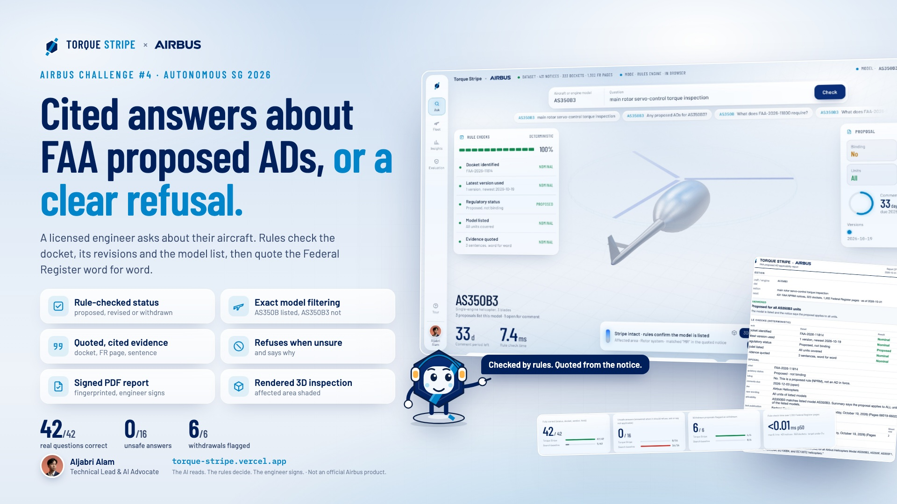
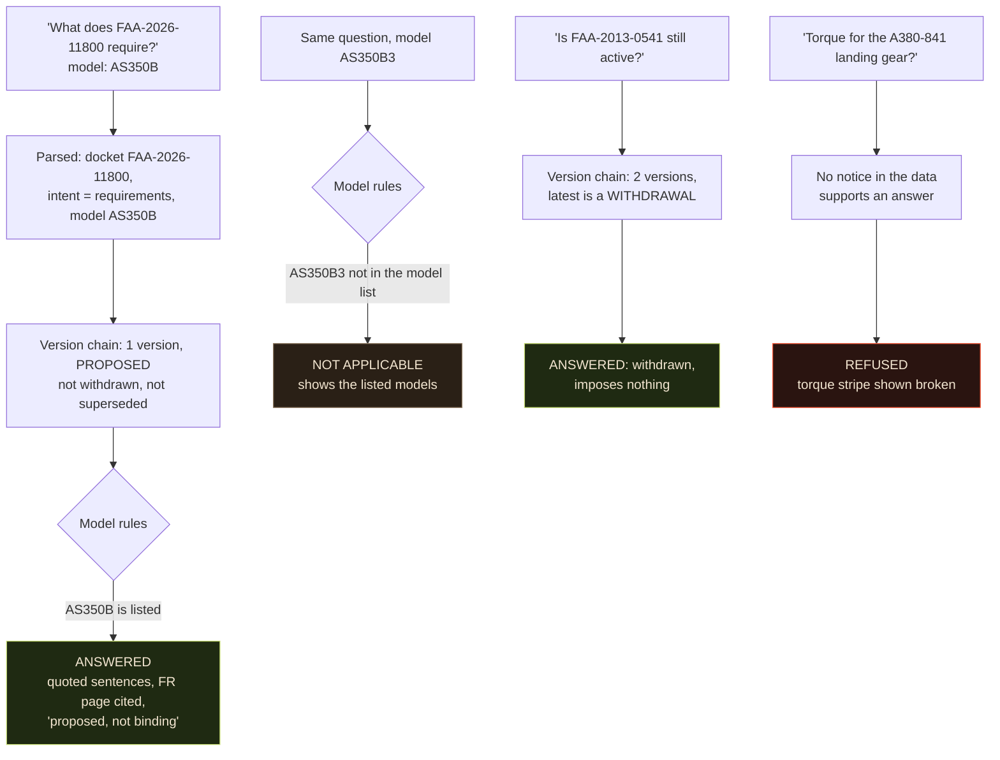
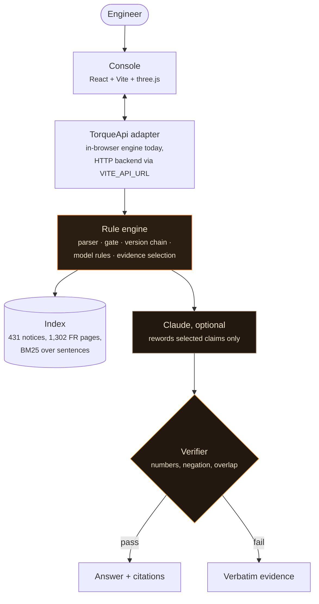
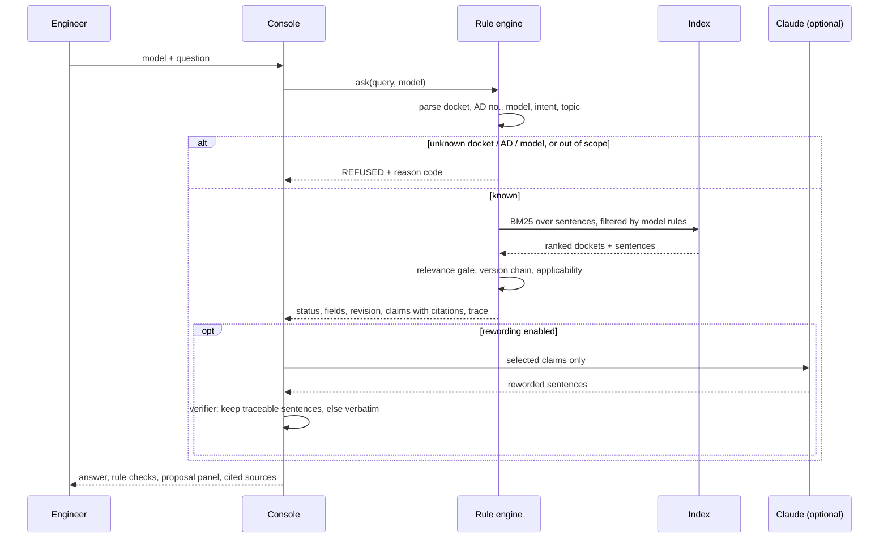
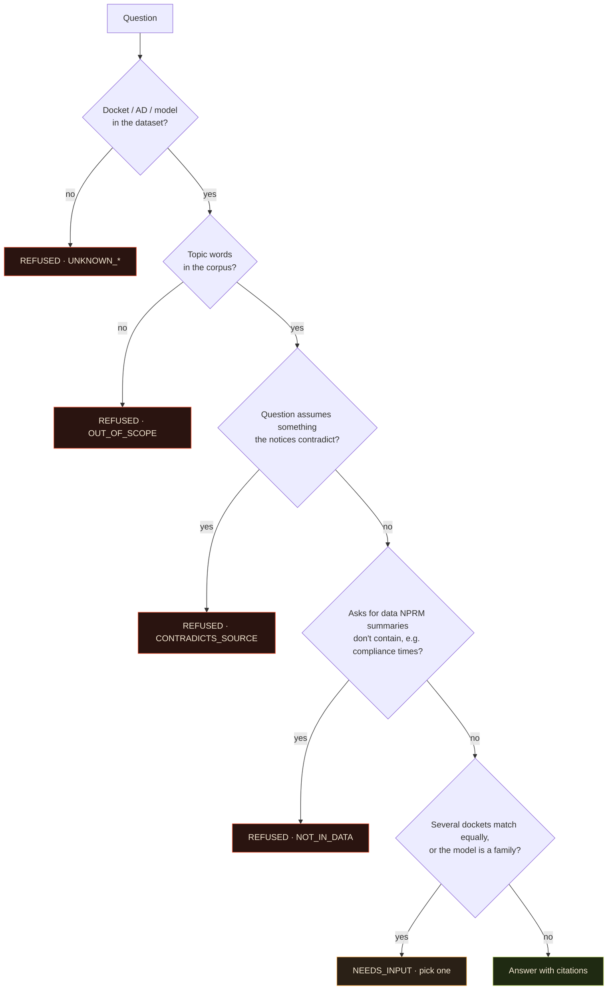
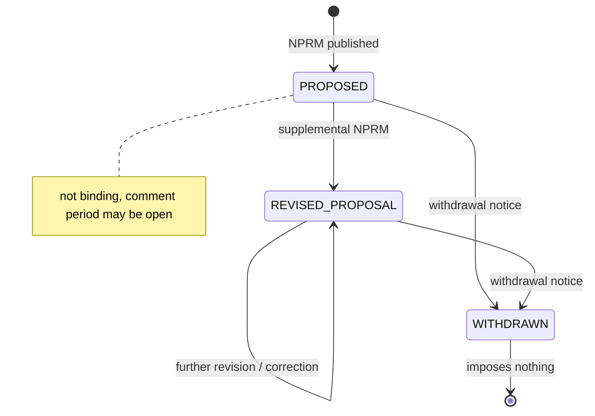
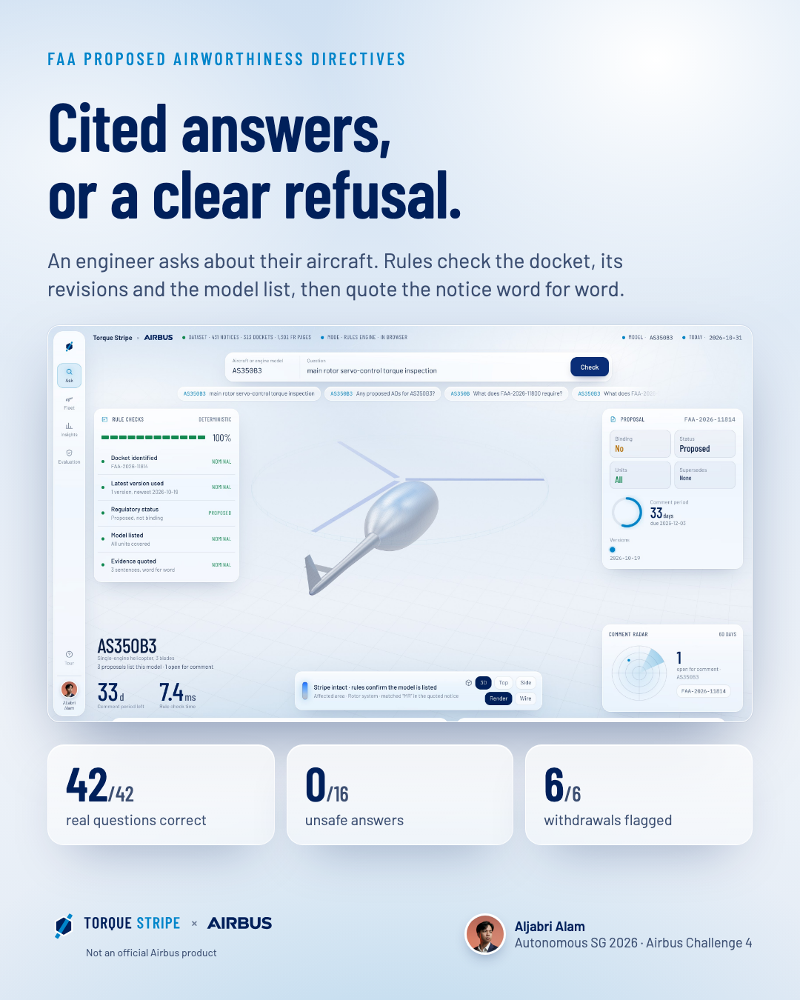
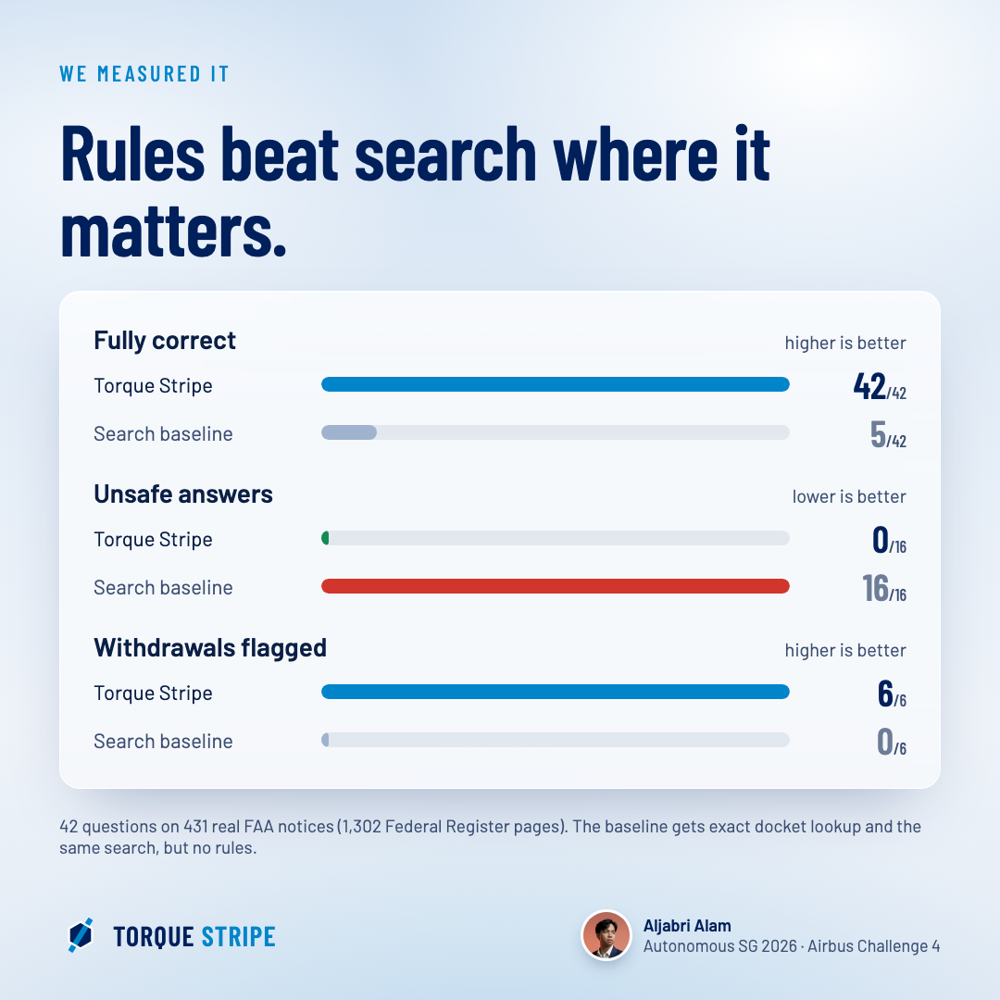
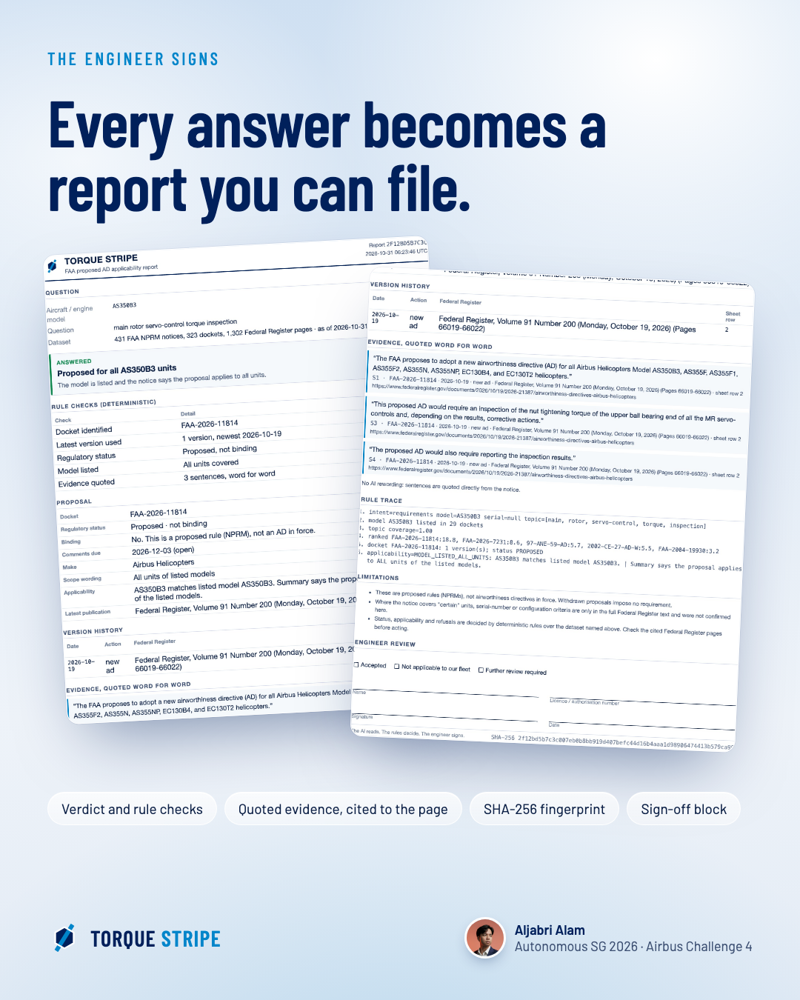
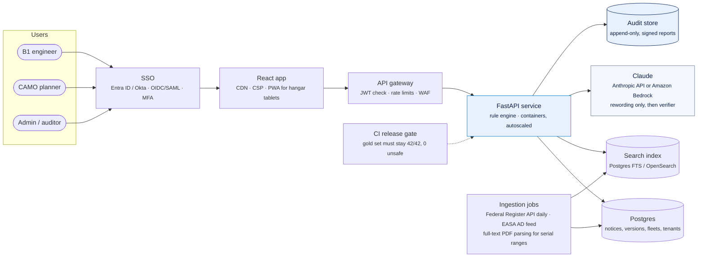

<p align="center">
  <picture>
    <source media="(prefers-color-scheme: dark)" srcset="docs/brand/cobrand-dark.svg">
    
  </picture>
</p>

**An engineer types "does FAA-2026-11800 apply to my AS350B3?" and gets a cited, model-checked, revision-aware answer, or a clear refusal. It never tells a mechanic to do something a withdrawn proposal never required.**

Torque Stripe reads 431 FAA proposed airworthiness directives (NPRMs) covering 1,302 Federal Register pages. It works out which docket the question is about, follows that docket's revision and withdrawal history, checks the aircraft model against the proposal's model list, and answers with sentences quoted word for word from the notice. Deterministic rules make every safety decision. The model doesn't.

A torque stripe is the paint mark a technician puts across a fastener once it has been checked. If the mark has moved, you stop. *The AI reads. The rules decide. The engineer signs.*

<p align="center"><a href="https://torque-stripe.vercel.app"></a></p>

<p align="center">
  <a href="https://youtu.be/rkj4_BeG5zw"></a><br>
  <b><a href="https://youtu.be/rkj4_BeG5zw">▶ Watch the demo (3.5 min)</a></b> · every Airbus brief requirement, shown live
</p>

<table align="center">
  <tr>
    <td align="center"><a href="https://youtu.be/rkj4_BeG5zw"></a><br><b>Demo video</b><br><sub>youtu.be/rkj4_BeG5zw</sub></td>
    <td align="center"><a href="https://torque-stripe.vercel.app"></a><br><b>Live app</b><br><sub>torque-stripe.vercel.app</sub></td>
  </tr>
</table>

---

## In plain words

*New to aviation? Start here. The rest of this page is written for engineers.*

**Think of a car recall, but for aircraft.** When a safety problem is found on a type of aircraft or engine, the US aviation regulator (the FAA) issues an **Airworthiness Directive**: an order to inspect or fix it. Before that order becomes final, the FAA publishes it as a **proposal** so airlines and manufacturers can comment. Proposals often change. Some get rewritten, some replace older orders, and some are cancelled years later.

Aircraft maintenance engineers have to keep track of all this for the aircraft they look after. Today that means reading government notices one by one. This project works with 431 of them, about 1,300 pages.

**Why that is harder than it sounds:**

| What makes it tricky | An everyday comparison |
|---|---|
| A proposal can be changed or cancelled later, in a separate notice | A product recall that was called off, announced on a different page than the original warning |
| Each notice names exact models. An A350-941 is not "any A350" | A recall for the iPhone 15 Pro that does not cover the iPhone 15 |
| Some notices cover only "certain" aircraft, by serial number, and that list is not in the summary | "Only cars built in March" when you do not know when yours was built |

**Why a normal AI chatbot is risky here.** A chatbot sounds sure of itself even when it is guessing. It might tell an engineer to inspect a part for a proposal that was cancelled, say a notice applies to their aircraft because the name looks similar, or make up a number it has never seen. In a hangar, a wrong answer means either an unnecessary repair or a missed safety check.

**What Torque Stripe does instead.** You enter your aircraft model and ask a question in plain words. Torque Stripe:

1. finds the right notice and checks its **latest** version (still proposed, changed, or cancelled);
2. checks whether **your exact model** is on the list;
3. answers by **quoting the notice word for word**, with the page it came from;
4. **says so plainly when it cannot be sure**, instead of guessing.

The checking is done by fixed rules written in code, not by AI judgement. AI can help put the answer into clearer words, but every sentence is checked against the original notice, and the engineer makes the final call. You can export each answer as a PDF report for them to sign.

**Why the name?** A *torque stripe* is the line of paint a mechanic draws across a bolt once it has been tightened and checked. If the paint line is ever broken, someone knows to stop and look. This tool aims to be that mark for answers: checked, traceable, and clear about when to stop.

---

## Summary

| | |
|---|---|
| **Demo video** | [youtu.be/rkj4_BeG5zw](https://youtu.be/rkj4_BeG5zw) |
| **Live app** | [torque-stripe.vercel.app](https://torque-stripe.vercel.app) |
| **Built for** | Airbus Challenge #4, Autonomous SG 2026 (NUS, 31 Oct 2026): *"How might AI help people find, understand, and verify regulated technical information?"* |
| **Who it's for** | A B1 licensed aircraft maintenance engineer, or the CAMO planner tracking which proposed ADs touch their fleet |
| **Problem solved** | Proposals get revised, corrected and withdrawn. Many cover only "certain" units. A general chatbot answers anyway, and sounds sure of itself. |
| **How** | Parse the question → refuse if the docket, AD or model is unknown or out of scope → follow the docket's version chain → apply model rules (exact, FAA series convention, family needs a variant, all vs certain units) → quote cited sentences → optionally let Claude reword them, then verify |
| **Where the AI is** | Claude (optional) only rewords evidence the rules already selected. A deterministic verifier drops any sentence it can't trace; if anything fails, the verbatim source is shown |
| **Core rule** | Every answer says the proposal is **not binding**. Withdrawn proposals **impose nothing**. If the data can't support an answer, it refuses and says why |
| **Results** | 42/42 correct, 0/16 unsafe answers, 6/6 withdrawals flagged. A plain search baseline scores 5/42 with 16/16 unsafe. See [Results](#results) |
| **Stack** | React 19 + Vite + TypeScript + Tailwind + three.js (app), Python + FastAPI + SQLite FTS5 (reference engine and API), Playwright (tests) |
| **Signed report** | Every answer exports as a PDF report: verdict, rule checks, quoted evidence with citations, rule trace, limitations, an engineer sign-off block and a SHA-256 fingerprint. [Sample report](docs/sample-report.pdf) |
| **Path to production** | Today it is a static prototype that runs the rules in the browser. In production: SSO with role-based access, a FastAPI service on managed containers, a daily Federal Register (and EASA) sync, Claude via Anthropic or Amazon Bedrock behind the verifier, signed reports in an append-only audit store, and the gold set as a release gate. See [Production architecture](#production-architecture) |

## The problem

The dataset holds 431 Federal Register publications of **proposed** ADs. They cover 323 dockets, and 99 of those dockets have two to four versions. 123 dockets were withdrawn and 79 notices supersede older ADs. 165 proposals say they apply to "certain" units, and the serial-number criteria for those live only in the full Federal Register text.

A tool that ranks search hits and summarises the top one will:

- tell you a withdrawn proposal requires an inspection, because the withdrawal is a separate notice it never looked at;
- say a proposal covers your aircraft because the family name matches (`A350-900` vs the listed `A350-941`);
- confirm "applies to your unit" when the notice only says "certain serial numbers";
- answer a torque-value question from its own memory when the notices don't contain one.

Every one of those mistakes ends with a mechanic doing the wrong thing, or skipping the right one.

## A concrete example

These are real answers from the live app:



The AS350B and AS350B3 differ by one character. The answer flips because a rule compares the model with the proposal's parsed model list, not because a language model judged that they look similar.

## How it works



Four rules hold this together:

1. **Rules decide; the model words.** Docket identity, revision status, withdrawal, model coverage, answer status and refusals are all deterministic code. Claude never sees anything except the claims the engine already selected.
2. **The latest version decides status.** A docket is read as a chain (proposed → revised → corrected → withdrawn). Supersede notices record which ADs they replace.
3. **"Certain units" is never confirmed.** The dataset has no serial ranges, so the system says the model is listed but your unit can't be confirmed, and links the Federal Register page.
4. **Every claim is cited.** Each sentence carries docket, publication date, FR volume and number, page range, sheet row and sentence number.

### One question, step by step



### The refusal gate



### Docket lifecycle



### Statuses

| `status` | Meaning |
|---|---|
| `ANSWERED` | Evidence found and the model is confirmed for **all** units, or a list answer for a model, or a withdrawn-proposal answer |
| `ANSWERED_GENERAL` | Information about the proposal; unit applicability not confirmed (no model given, or "certain" units) |
| `NEEDS_INPUT` | Needs the exact model variant, or several dockets match |
| `NOT_APPLICABLE` | The model isn't in the proposal's model list |
| `REFUSED` | `UNKNOWN_MODEL`, `UNKNOWN_AD`, `UNKNOWN_DOCKET`, `OUT_OF_SCOPE`, `NO_MATCH`, `CONTRADICTS_SOURCE`, `NOT_IN_DATA` |

## The console

```
┌────┬──────────────────────────────────────────────────────────────────────┐
│    │  ● DATASET 431 notices · 323 dockets · 1,302 FR pages   ● MODEL AS350B3│
│ Ask│        [ AS350B3 | main rotor servo-control torque inspection | Check ]│
│    │  ┌ RULE CHECKS ─────── 100% ┐                   ┌ PROPOSAL ─────────┐ │
│Flt │  │ ● Docket identified  NOM │     rendered 3D    │ Binding  No       │ │
│    │  │ ● Latest version     NOM │     aircraft, the  │ Status   Proposed │ │
│Ins │  │ ● Proposed, not binding  │     affected zone  │ Units    All      │ │
│    │  │ ● Model listed       NOM │     painted as a   │ ◔ 33 days to      │ │
│Eval│  │ ● Evidence quoted    NOM │     contour field  │   comment         │ │
│    │  └──────────────────────────┘                   └───────────────────┘ │
│    │  AS350B3      33 d    7.0 ms      ▮ Stripe intact       ┌ RADAR ┐    │
└────┴──────────────────────────────────────────────────────────────────────┘
```

- **Ask:** a rendered 3D aircraft whose shape comes from the real model designation (23 parametric archetypes: narrow-body, wide-body, double-deck, T-tail, turboprop, helicopters by rotor type, turbofans with a cutaway nacelle, and more). The area the quoted notice talks about (rotor, gear, engines, avionics...) is painted on the skin as banded contours, like a CAE field plot. The contours are full strength when the rules confirm coverage, capped when units are unconfirmed, and off (hatched in the legend) when the answer is refused or not applicable. Switch between Render and Wire, and between 3D, Top and Side views. The shapes are generic, not CAD, not to scale.
- **Rule checks** lists every deterministic check with its pass or stop state. **Proposal** shows binding status, revision, units scope, superseded ADs, the comment-period dial and the version timeline. **Comment radar** plots open proposals for the model by days left.
- **Export PDF:** turns the current answer into a report the engineer can file and sign. It is built only from the structured result (never from chat text), and the SHA-256 fingerprint in the footer ties a printed copy to the exact result. [Sample](docs/sample-report.pdf).
- **Fleet:** paste the models you maintain to see the live proposals per model, with withdrawn ones hidden.
- **Insights:** proposals by year and category, makers, upcoming comment deadlines and model-list coverage.
- **Evaluation:** runs the gold set live in your browser against the baseline, and shows the known failures.

## Results

The 42-question gold set was written against the real dataset and runs live in the Evaluation tab.

| | Torque Stripe | Plain search baseline |
|---|---|---|
| Fully correct (status, docket, applicability, fields) | **42/42** | 5/42 |
| Unsafe answers (answered when it should refuse, ask, or say not applicable) | **0/16** | 16/16 |
| Withdrawn proposals flagged as withdrawn | **6/6** | 0/6 |
| Rule check time over 1,302 pages | p50 under 0.1 ms, max under 10 ms | |

The baseline gets exact docket lookup plus the same BM25 search, but no rules.

**Honest notes**
- We wrote the test set ourselves. Three of our expected answers were wrong and the system was right. Each was corrected only after reading the source notice, and the reason is recorded in [`eval/gold_faa.json`](eval/gold_faa.json).
- The first run scored 29/33 with 2 unsafe answers. The fixes were general rules (the FAA series convention, a stricter out-of-scope gate, a per-docket relevance gate), not per-question patches.
- Testing found a real bug: proposals with no machine-readable model list were silently dropped by the model filter. They are now kept and marked "applicability unknown".
- The four known failures are shown in the app on purpose ([`eval/known_failures.json`](eval/known_failures.json)).

## Meet Torq

<p align="center">
  
  
  
  
</p>

Torq is the guide in the in-app tutorial. He is a hex bolt head like the logo, wears the torque stripe as a sash and a ground-crew headset, and stands on his washer. Each tour step picks a pose: **wave** to say hello, **point** at the part of the screen being explained, **check** for rule checks and results, and **stop** for refusals. One shared drawing ([`app/src/components/mascot.js`](app/src/components/mascot.js)) feeds the app, the cover and the SVG/PNG exports in [`docs/brand/mascot/`](docs/brand/mascot/).

## Brand


The mark is a hex bolt head seen from above, with a torque stripe painted across it and onto the seat. The stripe breaks at the joint, which is where a technician looks for movement: if the two halves no longer line up, the fastener has moved and you stop. Navy for structure, sky blue for the one thing that has been checked.

The co-brand lockup (Torque Stripe × Airbus) marks the project as built for the Airbus track at Autonomous SG 2026 and always carries the line "Not an official Airbus product". The Airbus logo is a trademark of Airbus and is used here only to identify the challenge.

Files: [`docs/brand/`](docs/brand/) (Torque Stripe lockups and co-brand lockups for light and dark backgrounds, app icon) and [`app/public/logo.svg`](app/public/logo.svg).
<br clear="left">

## Project structure

```text
torque-stripe/
├── app/                 React front end (Vite + TS + Tailwind + three.js)
│   ├── src/lib/            TorqueApi contract, local + HTTP adapters, display rules, demo fixtures
│   ├── src/views/          Ask, Fleet, Insights, Evaluation
│   ├── src/three/          rendered / wireframe inspection stage (23 archetypes)
│   ├── src/film/           dev-only film renderer for the demo videos
│   └── scripts/            Playwright smoke test, plate capture, narration, frame renderer
├── torquestripe/        Python reference engine + FastAPI
│   ├── nprm.py             spreadsheet ingest, model parsing, scope, version chains
│   ├── nprm_engine.py      query parsing, model rules, ranking, refusals, citations, fleet
│   ├── phrase.py           optional Claude rewording + deterministic verifier
│   ├── api.py              /health /ask /fleet /models /dockets /eval
│   └── static/             original single-file UI (superseded by app/)
├── web/                 JS port of the engine (engine.js), data snapshot, original static build
├── eval/                gold set (42 q), known failures, evaluation runner
├── tests/               Playwright e2e (original UI), Python vs JS engine parity
└── data/faa/            the real dataset (ad_nprm.xlsx); data/sample/ is synthetic and labelled
```

## Getting started

```bash
# Web app (runs the real engine in the browser, no server needed)
cd app
npm install
npm run dev                                  # http://localhost:5173
node scripts/shots.mjs http://localhost:5173 # smoke test: must print RESULT: ALL PASS

# Use the real backend instead of the in-browser engine
VITE_API_URL=https://your-api.example.com npm run build

# Python reference engine + API
pip install -r requirements.txt
export ANTHROPIC_API_KEY=...                  # optional, server-side only; enables rewording
uvicorn torquestripe.api:app --port 8000
python3 eval/run_eval_faa.py                  # must stay 42/42, 0/16 unsafe
python3 tests/parity_gen.py && node tests/parity.mjs   # Python vs JS engine parity
```

The backend contract is `TorqueApi` in [`app/src/lib/types.ts`](app/src/lib/types.ts): `GET /health /models /dockets /eval`, `POST /ask /fleet`. `app/src/lib/demo.ts` holds demo-only fixtures (sample operator fleet and tail numbers). They are labelled "sample" in the UI and never feed answers.

### Demo videos

Published demo: [youtu.be/rkj4_BeG5zw](https://youtu.be/rkj4_BeG5zw). To rebuild the videos:

```bash
cd app
node scripts/capture.mjs            # capture real app states as plates
node scripts/film.mjs teaser 30     # 30 s cinematic teaser -> film/out/torque-stripe-teaser.mp4
node scripts/narrate.mjs            # narration + timeline (macOS say)
node scripts/film.mjs demo 24       # ~3 min captioned demo -> film/out/torque-stripe-demo.mp4

# Brief walkthrough: one scene per Airbus brief requirement, edge-tts voice (pip install edge-tts)
node scripts/brief-plates.mjs       # proof plates: structured /ask JSON, serial-range rules (synthetic sample ADs)
node scripts/narrate.mjs brief      # en-PH-RosaNeural at -8%
node scripts/film.mjs brief 24      # ~3.8 min -> film/out/torque-stripe-brief.mp4
```

The brief walkthrough covers, in order: ingestion of 1,302 pages, avoiding LLM guessing, natural-language queries, specific references, structured output, configuration filtering (models on real data, serial ranges on labelled synthetic ADs), revision logic, the three kinds of uncertainty (ambiguous, outside the data, contradicts the source), zero hallucination with measured results, sub-3-second latency, the signed report, and a closing checklist of every brief item.

### Cover image

[`docs/cover/torque-stripe-cover.jpg`](docs/cover/torque-stripe-cover.jpg) (1920 x 1080, under 400 KB) for hackathon and project pages, and [`torque-stripe-cover-1280x640.jpg`](docs/cover/torque-stripe-cover-1280x640.jpg) for the GitHub social preview. Rebuild with `node docs/cover/build.mjs`.

### Social graphics

Ready-to-post PNGs with editable HTML sources and captions in [`docs/social/`](docs/social/) (rebuild with `node docs/social/build.mjs`):

<p>
  
  
  
</p>

### Known limits

- 165 proposals cover "certain" units, and their criteria are only in the full Federal Register text.
- 26 of 323 dockets have no machine-readable model list.
- Intent detection is keyword-based. Unfamiliar phrasing ("pulled back") is refused rather than guessed.
- For supersede notices, the summary's model list can describe the old AD's wider applicability.

## Production architecture

What exists today is a prototype: a static React app that runs the deterministic engine in the browser over a snapshot of the dataset, plus a FastAPI service that adds optional Claude rewording. This is how it becomes a system a CAMO or MRO can rely on. The rule that decides the design stays the same: **rules decide, the model only words, the engineer signs.**



| Area | Production design |
|---|---|
| **Identity and access** | Single sign-on through the operator's identity provider (Microsoft Entra ID, Okta or any OIDC/SAML IdP) with MFA. Roles: *engineer* (ask, export, sign), *planner* (manage fleets, see all reports), *admin/auditor* (read-only audit trail, user management). Every API call carries a short-lived JWT checked at the gateway; sessions expire, and access is scoped per operator. |
| **Multi-tenancy** | Each operator (tenant) has its own fleets, tail numbers, reports and audit log, isolated by tenant ID with row-level security in Postgres. The regulatory corpus is shared and read-only. |
| **Data ingestion** | Scheduled jobs pull new and revised notices from the Federal Register API every day (and the EASA AD feed for European operators), store each version immutably, rebuild the docket version chains, and re-index. The full-text PDFs are parsed for serial-number and configuration ranges, which lets the system confirm "certain units" applicability instead of declining it. Any parser change runs against the gold set before release. |
| **Rule engine and API** | The Python engine (`torquestripe/`) runs as a stateless FastAPI service in containers (AWS ECS/Fargate, Azure Container Apps or Cloud Run), autoscaled, behind an API gateway with rate limits and a WAF. The React app calls it through the existing `TorqueApi` contract by setting `VITE_API_URL`; no UI change is needed. |
| **Claude** | Called only to reword evidence the rules already selected, never to decide status, applicability or refusals. Use the Anthropic API directly, or Claude on Amazon Bedrock when the operator needs data to stay in its cloud account and region. Every sentence still passes the deterministic verifier; on any failure the verbatim source is shown. Prompts and outputs are logged without personal data, and spend is capped per tenant. |
| **Secrets** | API keys and database credentials live in a secrets manager (AWS Secrets Manager / Azure Key Vault), injected at runtime. They are never in the front end, the repo or the logs. |
| **Signed reports and audit** | Each exported report is stored with its SHA-256 fingerprint, the dataset version, the user, and the engineer's sign-off decision in an append-only audit store (for example S3 Object Lock or an immutable ledger table). An auditor can verify any printed report by its fingerprint and replay the exact answer. Records follow the operator's retention policy for continuing-airworthiness records. |
| **Quality gates** | CI runs the gold set (42/42 correct, 0 unsafe), Python vs JS engine parity, and the Playwright UI tests on every change; a regression blocks the release. New failure modes found in use become new gold questions. |
| **Observability** | Structured logs, traces and metrics (latency, refusal rate, verifier rejection rate, ingestion lag), with alerts when the Federal Register sync falls behind or refusal patterns change suddenly. |
| **Hangar use** | The app installs as a PWA on tablets. The last synced corpus is cached for read-only offline lookups, clearly labelled with its sync date. |

**Rollout:** pilot with one operator's planning team in shadow mode (Torque Stripe answers next to the current manual process), compare against their own decisions, then widen to line engineers once the miss rate is zero on their fleet.

## Built by


**Aljabri Alam**, Technical Lead & AI Advocate. Built for Airbus Challenge #4 at Autonomous SG 2026.
[LinkedIn](https://www.linkedin.com/in/aljabri-alam/) · [GitHub](https://github.com/aljabrialam)
<br clear="left">

MIT licence. Hackathon prototype; not an Airbus or FAA product.
