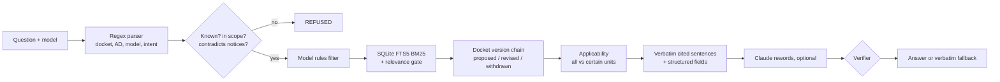

# Torque Stripe

**Cited, rule-checked answers about FAA proposed airworthiness directives.**
*The AI reads. The rules decide. The engineer signs.*

Built for **Airbus Challenge #4** at Autonomous SG 2026 (NUS, 31 Oct 2026). Made by [Aljabri Alam](https://www.linkedin.com/in/aljabri-alam/).

A torque stripe is the paint mark a technician puts across a fastener once it has been checked. If the mark has moved, you stop. Torque Stripe does that for answers about airworthiness directives.

---

## For judges (non-technical)

### The problem
A licensed aircraft maintenance engineer, or the planner who tracks directives for a fleet, has to know which FAA proposals touch their aircraft. Today that means reading Federal Register notices one by one. Proposals get revised, corrected and withdrawn; many cover only "certain" serial numbers; and a general chatbot will happily say "you must do X" about a proposal that was withdrawn years ago.

### What it does
- **Ask** in plain words, with your aircraft or engine model set. Every answer:
  - starts with a status: Answered, Needs input, Not applicable or Refused;
  - says whether the proposal is **still proposed (not binding)**, **revised** or **withdrawn**;
  - quotes the FAA notice word for word, with the docket, Federal Register page and sentence number;
  - shows a "Why this answer" checklist of every rule that fired.
- **Refuses** when the data can't support an answer: an unknown model or AD, a question that contradicts the notices ("why was X withdrawn?" when it wasn't), or details the notices don't contain (compliance times).
- **Fleet check:** enter every model you maintain and see which proposals cover each one, and which comment periods are still open.
- **Evaluation tab:** runs our 42-question test set live against a plain-search baseline, and lists where the system still fails and why.

### Results on the real dataset (431 FAA notices, 323 dockets, 1,302 Federal Register pages)

| | Torque Stripe | Plain search baseline |
|---|---|---|
| Fully correct (status, docket, applicability, fields) | **42/42** | 5/42 |
| Unsafe answers (answered when it should refuse, ask, or say "not applicable") | **0/16** | 16/16 |
| Withdrawn proposals flagged as withdrawn | **6/6** | 0/6 |
| Slowest answer | under 10 ms | |

**Honest notes**
- We wrote the test set ourselves. Three of our expected answers were wrong, and the system was right; each was corrected only after reading the source notice and is documented in `eval/gold_faa.json`.
- Testing found a real bug: proposals with no machine-readable model list were silently dropped by the model filter, so a seatbelt proposal could be missed. Fixed; they are now kept and marked "applicability unknown".
- The data holds notice **summaries**, not full texts, so serial-number criteria can't be checked. The system says so and links the Federal Register page instead of guessing.

### Where the AI is (and isn't)
| Job | Done by |
|---|---|
| Which docket, which version is current, withdrawn or not | Rules |
| Does the proposal cover your model? | Rules (exact model, FAA series convention, "give the exact variant") |
| Answer status and refusals | Rules |
| Turning quoted evidence into readable sentences (optional) | Claude, checked by a verifier; on any mismatch the original text is shown |

---

## Technical

### Architecture


### Run locally
```bash
pip install -r requirements.txt
export ANTHROPIC_API_KEY=sk-ant-...      # optional; server-side only
uvicorn torquestripe.api:app --reload     # open http://localhost:8000
python3 eval/run_eval_faa.py              # gold-set evaluation (deterministic)
python3 tests/e2e.py http://localhost:8000  # Playwright end-to-end UI test
```

### Web app (React)
`app/` is the main front end: Vite + React + TypeScript + Tailwind, three.js stage, sepia glass theme. Live at https://torque-stripe.vercel.app.
```bash
cd app && npm install && npm run dev        # http://localhost:5173
npm run build                               # -> app/dist (static)
node scripts/shots.mjs http://localhost:5173  # Playwright smoke + screenshots; must print RESULT: ALL PASS
```
Data access goes through one interface, `TorqueApi` (`app/src/lib/types.ts`):
- **Default:** `localApi.ts` runs the real rule engine (`web/engine.js`) over the real dataset in the browser. No server.
- **Real backend:** set `VITE_API_URL=https://your-api` at build time and `api.ts` calls the same routes as `torquestripe/api.py` (`/health /models /ask /fleet /dockets /eval`).
- `app/src/lib/demo.ts` holds demo-only fixtures (sample operator fleet, tail numbers, demo questions). They are labelled "sample" in the UI and never feed answers.

The previous single-file UI is kept as a fallback at https://torque-stripe-classic.vercel.app.

### Serverless single-file build (classic UI)
`python3 web/build.py` produces `web/dist/index.html`: one self-contained page with the UI, the rule engine (`web/engine.js`, a JavaScript port of the Python engine) and the data. No server needed. Parity with the Python engine is checked by `python3 tests/parity_gen.py && node tests/parity.mjs`: 494/495 structured questions identical; the only differences are the order of exactly tied search scores. Claude rewording is off in this mode.

### Deploy
Vercel, no build step. `api/index.py` serves the FastAPI app (UI, API, live evaluation); `vercel.json` routes everything to it and bundles the dataset. Set `ANTHROPIC_API_KEY` as a Vercel environment variable to enable rewording.

### Code map
| Path | What |
|---|---|
| `torquestripe/nprm.py` | Spreadsheet ingest: action type, model parsing (FAA shorthand like "A330-243, -243F"), all/certain scope, docket version chains |
| `torquestripe/nprm_engine.py` | Query parsing, model rules, ranking, contradiction and not-in-data refusals, citations, fleet check |
| `torquestripe/phrase.py` | Optional Claude rewording + deterministic verifier (exact numbers, no added negation, 70% word overlap) |
| `torquestripe/api.py` | FastAPI: `/ask`, `/fleet`, `/dockets/{d}`, `/models`, `/eval`, UI at `/` |
| `app/` | React front end (views in `src/views`, API adapters in `src/lib`, three.js stage in `src/three/stage.js`) |
| `torquestripe/static/` | Classic UI (vanilla HTML/CSS/JS, motion.dev bundled locally), logo, icons, social image |
| `eval/` | Gold set, known failures, evaluation runner |
| `tests/e2e.py` | Playwright UI test: every demo path, tour, fleet, evaluation, mobile width, console errors |
| `torquestripe/engine.py`, `parse.py`, `applicability.py`, `data/sample/` | Earlier engine for full-text ADs with serial ranges, run on four **synthetic** sample ADs |

### Known limits
- 165 proposals cover "certain" units; their criteria are only in the full Federal Register text.
- 26 of 323 dockets have no machine-readable model list.
- Intent detection is keyword-based; unfamiliar phrasing ("pulled back") is refused rather than guessed.
- For "supersede" notices, the summary's model list can describe the old AD's wider applicability.

### Licence
MIT. See `LICENSE`.
