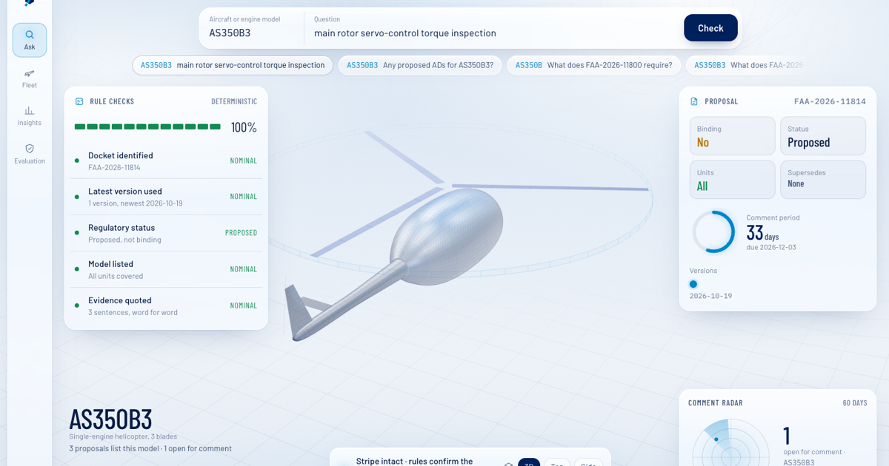
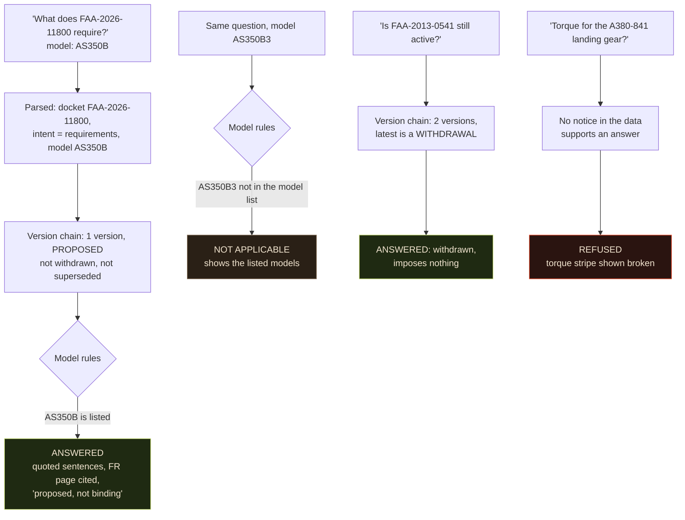
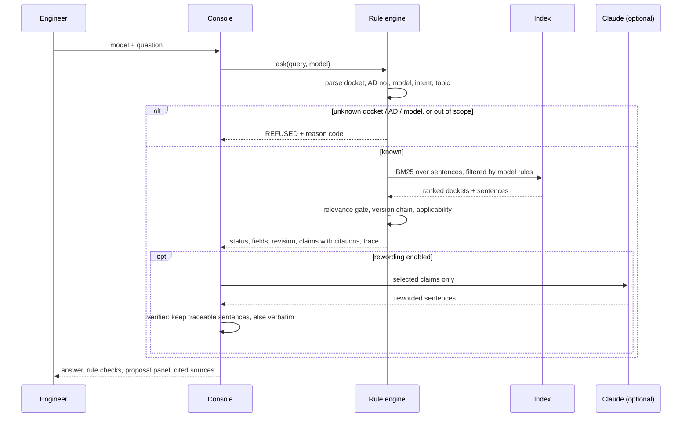
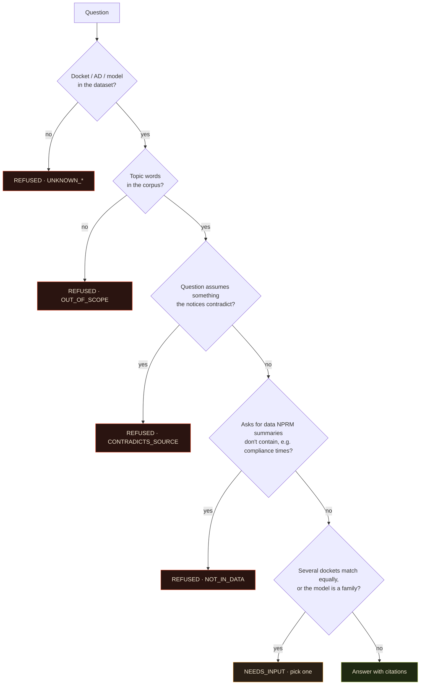
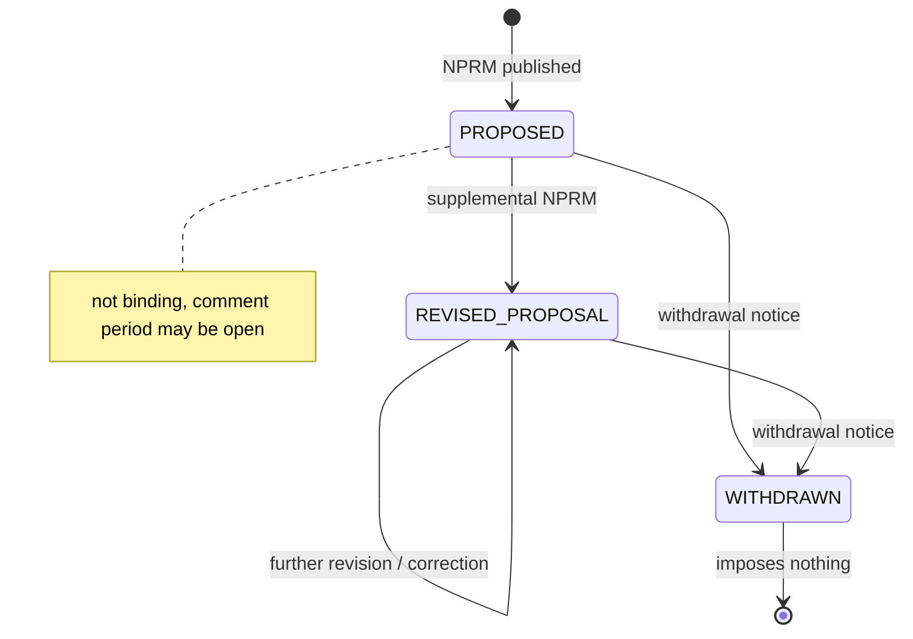

# Torque Stripe

**An engineer types "does FAA-2026-11800 apply to my AS350B3?" and gets a cited, model-checked, revision-aware answer, or a clear refusal. It never tells a mechanic to do something a withdrawn proposal never required.**

Torque Stripe reads 431 FAA proposed airworthiness directives (NPRMs) covering 1,302 Federal Register pages. It works out which docket the question is about, follows that docket's revision and withdrawal history, checks the aircraft model against the proposal's model list, and answers with sentences quoted word for word from the notice. Deterministic rules make every safety decision. The model doesn't.

A torque stripe is the paint mark a technician puts across a fastener once it has been checked. If the mark has moved, you stop. *The AI reads. The rules decide. The engineer signs.*

[](https://torque-stripe.vercel.app)

---

## Summary

| | |
|---|---|
| **Live app** | [torque-stripe.vercel.app](https://torque-stripe.vercel.app) (classic UI: [torque-stripe-classic.vercel.app](https://torque-stripe-classic.vercel.app)) |
| **Built for** | Airbus Challenge #4, Autonomous SG 2026 (NUS, 31 Oct 2026): *"How might AI help people find, understand, and verify regulated technical information?"* |
| **Who it's for** | A B1 licensed aircraft maintenance engineer, or the CAMO planner tracking which proposed ADs touch their fleet |
| **Problem solved** | Proposals get revised, corrected and withdrawn. Many cover only "certain" units. A general chatbot answers anyway, and sounds sure of itself. |
| **How** | Parse the question → refuse if the docket, AD or model is unknown or out of scope → follow the docket's version chain → apply model rules (exact, FAA series convention, family needs a variant, all vs certain units) → quote cited sentences → optionally let Claude reword them, then verify |
| **Where the AI is** | Claude (optional) only rewords evidence the rules already selected. A deterministic verifier drops any sentence it can't trace; if anything fails, the verbatim source is shown |
| **Core rule** | Every answer says the proposal is **not binding**. Withdrawn proposals **impose nothing**. If the data can't support an answer, it refuses and says why |
| **Results** | 42/42 correct, 0/16 unsafe answers, 6/6 withdrawals flagged. A plain search baseline scores 5/42 with 16/16 unsafe. See [Results](#results) |
| **Stack** | React 19 + Vite + TypeScript + Tailwind + three.js (app), Python + FastAPI + SQLite FTS5 (reference engine and API), Playwright (tests) |

## The problem

The dataset holds 431 Federal Register publications of **proposed** ADs. They cover 323 dockets, and 99 of those dockets have two to four versions. 123 dockets were withdrawn and 79 notices supersede older ADs. 165 proposals say they apply to "certain" units, and the serial-number criteria for those live only in the full Federal Register text.

A tool that ranks search hits and summarises the top one will:

- tell you a withdrawn proposal requires an inspection, because the withdrawal is a separate notice it never looked at;
- say a proposal covers your aircraft because the family name matches (`A350-900` vs the listed `A350-941`);
- confirm "applies to your unit" when the notice only says "certain serial numbers";
- answer a torque-value question from its own memory when the notices don't contain one.

Every one of those mistakes ends with a mechanic doing the wrong thing, or skipping the right one.

## A concrete example

These are real answers from the live app:



The AS350B and AS350B3 differ by one character. The answer flips because a rule compares the model with the proposal's parsed model list, not because a language model judged that they look similar.

## How it works


Four rules hold this together:

1. **Rules decide; the model words.** Docket identity, revision status, withdrawal, model coverage, answer status and refusals are all deterministic code. Claude never sees anything except the claims the engine already selected.
2. **The latest version decides status.** A docket is read as a chain (proposed → revised → corrected → withdrawn). Supersede notices record which ADs they replace.
3. **"Certain units" is never confirmed.** The dataset has no serial ranges, so the system says the model is listed but your unit can't be confirmed, and links the Federal Register page.
4. **Every claim is cited.** Each sentence carries docket, publication date, FR volume and number, page range, sheet row and sentence number.

### One question, step by step



### The refusal gate



### Docket lifecycle



### Statuses

| `status` | Meaning |
|---|---|
| `ANSWERED` | Evidence found and the model is confirmed for **all** units, or a list answer for a model, or a withdrawn-proposal answer |
| `ANSWERED_GENERAL` | Information about the proposal; unit applicability not confirmed (no model given, or "certain" units) |
| `NEEDS_INPUT` | Needs the exact model variant, or several dockets match |
| `NOT_APPLICABLE` | The model isn't in the proposal's model list |
| `REFUSED` | `UNKNOWN_MODEL`, `UNKNOWN_AD`, `UNKNOWN_DOCKET`, `OUT_OF_SCOPE`, `NO_MATCH`, `CONTRADICTS_SOURCE`, `NOT_IN_DATA` |

## The console

```
┌────┬──────────────────────────────────────────────────────────────────────┐
│    │  ● DATASET 431 notices · 323 dockets · 1,302 FR pages   ● MODEL AS350B3│
│ Ask│        [ AS350B3 | main rotor servo-control torque inspection | Check ]│
│    │  ┌ RULE CHECKS ─────── 100% ┐                   ┌ PROPOSAL ─────────┐ │
│Flt │  │ ● Docket identified  NOM │     rendered 3D    │ Binding  No       │ │
│    │  │ ● Latest version     NOM │     aircraft with  │ Status   Proposed │ │
│Ins │  │ ● Proposed, not binding  │     torque stripe  │ Units    All      │ │
│    │  │ ● Model listed       NOM │     + affected     │ ◔ 33 days to      │ │
│Eval│  │ ● Evidence quoted    NOM │     zone           │   comment         │ │
│    │  └──────────────────────────┘                   └───────────────────┘ │
│    │  AS350B3      33 d    7.0 ms      ◯ Stripe intact       ┌ RADAR ┐    │
└────┴──────────────────────────────────────────────────────────────────────┘
```

- **Ask:** a rendered 3D aircraft whose shape comes from the real model designation (23 parametric archetypes: narrow-body, wide-body, double-deck, T-tail, turboprop, helicopters by rotor type, turbofans and more). The answer's topic highlights the affected zone. The torque stripe ring shows the verdict: intact, dashed (general), grey (not applicable) or broken (refused or needs input). Switch between Render and Wire, and between 3D, Top and Side views. The shapes are generic, not CAD, not to scale.
- **Rule checks** lists every deterministic check with its pass or stop state. **Proposal** shows binding status, revision, units scope, superseded ADs, the comment-period dial and the version timeline. **Comment radar** plots open proposals for the model by days left.
- **Fleet:** paste the models you maintain to see the live proposals per model, with withdrawn ones hidden.
- **Insights:** proposals by year and category, makers, upcoming comment deadlines and model-list coverage.
- **Evaluation:** runs the gold set live in your browser against the baseline, and shows the known failures.

## Results

The 42-question gold set was written against the real dataset and runs live in the Evaluation tab.

| | Torque Stripe | Plain search baseline |
|---|---|---|
| Fully correct (status, docket, applicability, fields) | **42/42** | 5/42 |
| Unsafe answers (answered when it should refuse, ask, or say not applicable) | **0/16** | 16/16 |
| Withdrawn proposals flagged as withdrawn | **6/6** | 0/6 |
| Rule check time over 1,302 pages | p50 under 0.1 ms, max under 10 ms | |

The baseline gets exact docket lookup plus the same BM25 search, but no rules.

**Honest notes**
- We wrote the test set ourselves. Three of our expected answers were wrong and the system was right. Each was corrected only after reading the source notice, and the reason is recorded in [`eval/gold_faa.json`](eval/gold_faa.json).
- The first run scored 29/33 with 2 unsafe answers. The fixes were general rules (the FAA series convention, a stricter out-of-scope gate, a per-docket relevance gate), not per-question patches.
- Testing found a real bug: proposals with no machine-readable model list were silently dropped by the model filter. They are now kept and marked "applicability unknown".
- The four known failures are shown in the app on purpose ([`eval/known_failures.json`](eval/known_failures.json)).

## Project structure

```text
torque-stripe/
├── app/                 React front end (Vite + TS + Tailwind + three.js)
│   ├── src/lib/            TorqueApi contract, local + HTTP adapters, display rules, demo fixtures
│   ├── src/views/          Ask, Fleet, Insights, Evaluation
│   ├── src/three/          rendered / wireframe inspection stage (23 archetypes)
│   ├── src/film/           dev-only film renderer for the demo videos
│   └── scripts/            Playwright smoke test, plate capture, narration, frame renderer
├── torquestripe/        Python reference engine + FastAPI
│   ├── nprm.py             spreadsheet ingest, model parsing, scope, version chains
│   ├── nprm_engine.py      query parsing, model rules, ranking, refusals, citations, fleet
│   ├── phrase.py           optional Claude rewording + deterministic verifier
│   ├── api.py              /health /ask /fleet /models /dockets /eval
│   └── static/             classic single-file UI
├── web/                 JS port of the engine (engine.js), data snapshot, classic static build
├── eval/                gold set (42 q), known failures, evaluation runner
├── tests/               Playwright e2e (classic UI), Python vs JS engine parity
└── data/faa/            the real dataset (ad_nprm.xlsx); data/sample/ is synthetic and labelled
```

## Getting started

```bash
# Web app (runs the real engine in the browser, no server needed)
cd app
npm install
npm run dev                                  # http://localhost:5173
node scripts/shots.mjs http://localhost:5173 # smoke test: must print RESULT: ALL PASS

# Use the real backend instead of the in-browser engine
VITE_API_URL=https://your-api.example.com npm run build

# Python reference engine + API
pip install -r requirements.txt
export ANTHROPIC_API_KEY=...                  # optional, server-side only; enables rewording
uvicorn torquestripe.api:app --port 8000
python3 eval/run_eval_faa.py                  # must stay 42/42, 0/16 unsafe
python3 tests/parity_gen.py && node tests/parity.mjs   # Python vs JS engine parity
```

The backend contract is `TorqueApi` in [`app/src/lib/types.ts`](app/src/lib/types.ts): `GET /health /models /dockets /eval`, `POST /ask /fleet`. `app/src/lib/demo.ts` holds demo-only fixtures (sample operator fleet and tail numbers). They are labelled "sample" in the UI and never feed answers.

### Demo videos

```bash
cd app
node scripts/capture.mjs            # capture real app states as plates
node scripts/film.mjs teaser 30     # 30 s cinematic teaser -> film/out/torque-stripe-teaser.mp4
node scripts/narrate.mjs            # narration + timeline (macOS say)
node scripts/film.mjs demo 24       # ~3 min captioned demo -> film/out/torque-stripe-demo.mp4
```

### Known limits

- 165 proposals cover "certain" units, and their criteria are only in the full Federal Register text.
- 26 of 323 dockets have no machine-readable model list.
- Intent detection is keyword-based. Unfamiliar phrasing ("pulled back") is refused rather than guessed.
- For supersede notices, the summary's model list can describe the old AD's wider applicability.

## Further reading

- Handoff and decision record: [`HANDOFF.md`](HANDOFF.md)
- Gold set and known failures: [`eval/`](eval/)

MIT licence. Built by [Aljabri Alam](https://www.linkedin.com/in/aljabri-alam/). Hackathon prototype; not an Airbus or FAA product.
